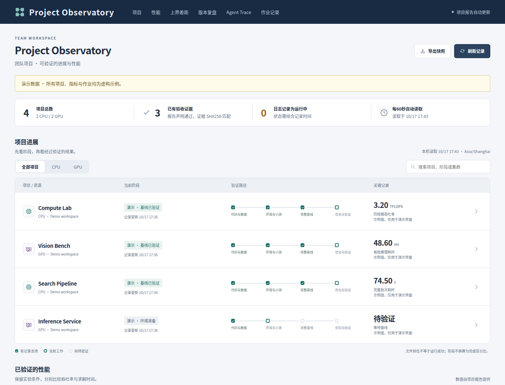

# Project Observatory

把项目进展、验收证据、性能图表和 Agent 时间线放在一个只读看板里。
这是一个可直接复用的 GitHub 仓库模板：Python 标准库后端、原生前端与本地 ECharts，运行时不需要 npm、数据库或外部 CDN。

A configurable, read-only project dashboard with synthetic demo data, evidence-bound metrics, local agent timelines, and standalone HTML export.



## 快速开始

需要 Python **3.10+**。点击 GitHub 的 **Use this template → Create a new repository**，然后在自己的仓库运行：

```bash
python3 server.py
```

打开 <http://127.0.0.1:8790>。默认加载 `examples/dashboard.json`，四个项目、所有指标和作业记录均为虚构，页面会明确标注“演示数据”。不会扫描家目录、连接集群、启动计算或访问飞书。

## 换成自己的项目

```bash
cp dashboard.example.json dashboard.local.json
mkdir -p local-data/my-project
cp examples/projects/compute/*.json local-data/my-project/
python3 server.py --config dashboard.local.json
```

先编辑 `dashboard.local.json` 中的标题、时区、阶段、项目名称、资源类型和项目目录，再替换项目目录里的 `dashboard.json` 与证据文件。路径相对**配置文件所在目录**，也可指定绝对项目目录；报告和证据路径相对**项目目录**。项目数量和名称不受演示项目限制。

替换完虚构记录后，把配置中的 `demo` 设为 `false`。`dashboard.local.json`、`local-data/`、`.env`、会话日志及导出产物默认被 Git 忽略。

项目报告支持：

- 项目阶段、主指标、下一步、限制条件和作业最近观测。
- 任意项目的单系列或多系列性能图表，注明单位和比较方向。
- 可选的参考上界、推导假设、版本复盘与经验记录。
- 证据文件的相对路径及 SHA256；验收声明和摘要匹配后才展示性能图表。

完整字段见 [数据接入说明](docs/configuration.md)。看板检查文件摘要与报告结构；科学结论和验收规则由报告生产者负责。

## 本机 Agent Trace

Trace 默认关闭。需要时，在自己的配置中设置：

```json
"traces": {
  "enabled": true,
  "sessions_dir": "~/.codex/sessions"
}
```

然后显式启用：

```bash
python3 server.py --config dashboard.local.json --enable-traces
```

只索引配置中项目目录及其子目录的会话。主会话与子 Agent 使用同一时钟，可切换时间范围、点击片段定位明细；原始工具输入输出、开发者消息和隐藏推理不会返回。消息内容有常见凭据脱敏和长度限制，自动脱敏不能保证识别所有私人内容。

详细接口同时检查连接来源、Host、Origin 和跨站请求标记，只接受本机访问。远程使用 SSH 隧道：

```bash
ssh -N -L 8790:127.0.0.1:8790 your-server
```

## 分享和部署

页面“导出快照”下载包含前端、图表库和当前项目数据的独立 HTML，双击即可打开；离线文件不含 Trace，也不会继续刷新。

```bash
python3 server.py --export artifacts/dashboard.html
```

`GET /api/dashboard` 返回聚合数据，`GET /api/health` 返回健康状态，`GET /download.json` 导出 JSON。接入真实数据后，聚合接口和快照可能包含项目报告正文，请自行决定分享范围。

也可以用 Docker 启动演示版：

```bash
docker build -t project-observatory .
docker run --rm -p 127.0.0.1:8790:8790 project-observatory
```

服务没有登录系统，默认只监听 loopback。自己的配置可通过只读卷挂载到容器；需要对外服务时应在有认证的反向代理后运行。

## 验证与贡献

```bash
python3 -m unittest discover -s tests -v
node --check static/app.js
npm ci
npx playwright install chromium
npm run test:browser
```

浏览器测试自行启动临时服务，覆盖桌面、手机、筛选、图表、详情、复盘、刷新、关闭的 Trace 和独立离线文件。GitHub Actions 会运行同样的检查。

问题或改进可提交 issue / pull request。请使用虚构的最小复现，不提交真实项目结果、会话、账号配置或密钥。

本项目使用 [MIT License](LICENSE)。本地 ECharts 5.6.0 使用 Apache-2.0，原始许可和 NOTICE 保留在 `static/vendor/`；见 [第三方声明](THIRD_PARTY_NOTICES.md)。
